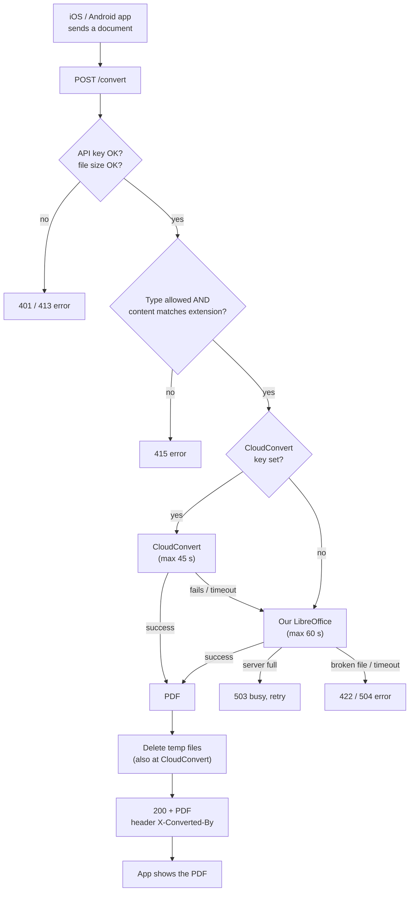
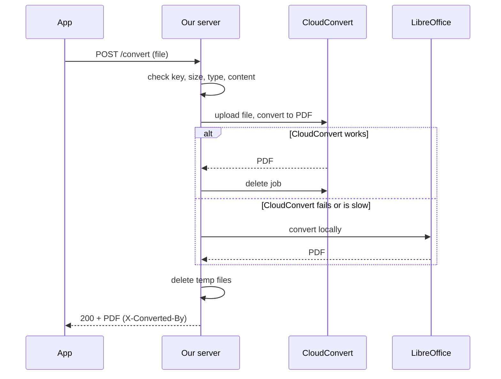

# How it works

> **PDF version (4 pages, easy to share):** [AirPrinter-Converter-Diagrams.pdf](AirPrinter-Converter-Diagrams.pdf)
> Pages: 1. Overview, 2. Request sequence, 3. Scaling, 4. Where user data goes. Sources: [diagrams/](diagrams/).

## In one picture

## Step by step (happy path)

## Who does what

| Part | Job |
|---|---|
| App (iOS / Android) | Picks the file, uploads it, shows the PDF or the error |
| Our server (Node + Express) | Checks the file, picks the engine, returns the PDF |
| CloudConvert | **First engine.** Converts online. Costs money per file |
| LibreOffice | **Backup engine.** Runs on our server. Free, but uses our CPU and RAM |

## Why two engines
- CloudConvert is the main one: good quality, and our server stays free.
- LibreOffice is the safety net: if CloudConvert is down, out of credits or slow, users still get a PDF.

## Where the file goes
1. Phone → our server (HTTPS)
2. Our server → CloudConvert (HTTPS)
3. CloudConvert → our server (PDF)
4. Our server → phone (PDF)

Our server and CloudConvert both delete the file right after.
